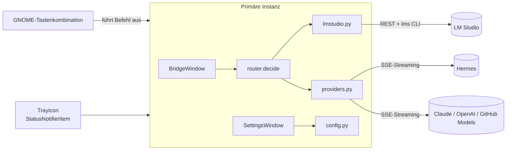

# Technische Dokumentation

🇬🇧 [English](TECHNICAL.md) | 🇩🇪 Deutsch

## Überblick

Einprozess-Anwendung in Python (GTK 4 über PyGObject, nur Standardbibliothek). Eine `Gtk.Application` mit `HANDLES_COMMAND_LINE` hält eine primäre Instanz am Leben (`hold()`); jeder weitere Start (die Tastenkombination führt denselben Befehl aus) wird an die primäre Instanz weitergereicht, die das Overlay ein- oder ausblendet.



## Module (`src/lms_hermes_bridge/`)

| Modul | Aufgabe |
|-------|---------|
| `app.py` | `BridgeApp` (Einzelinstanz, Aktionen, Kommandozeile `--background`), `BridgeWindow` (Overlay, Rechtsklick-Menü, Worker-Thread), Über-Dialog |
| `router.py` | Reine Entscheidungslogik: `classify`, `pick_model`, `decide`, `TIER_PARAMS`. Keine Ein-/Ausgabe |
| `lmstudio.py` | Modellerkennung (`GET /api/v0/models`, `lms ls --json` für Größen), `lms load/unload`, RAM-Erkennung |
| `providers.py` | Streaming-Clients: OpenAI-kompatibel (`/chat/completions`) und Anthropic (`/v1/messages`), SSE-Parsing, `ChatError` |
| `config.py` | JSON-Konfiguration in `~/.config/lms-hermes-bridge/config.json` (Rechte `0600`), Standardwerte, tiefes Zusammenführen, Anbieter-Vorlagen |
| `settings_dialog.py` | Einstellungsfenster mit Reitern (Allgemein, LM Studio, Hermes, Externe Modelle) |
| `tray.py` | StatusNotifierItem + `com.canonical.dbusmenu` über `Gio.DBusConnection` |
| `hotkey.py` | Registriert einen GNOME-Shortcut über `gsettings` (`Gio.Settings`) |
| `services.py` | Startet den lokalen LM-Studio-Server (`lms server start`, Ausweichen auf `lms daemon up`) und das Hermes-Gateway (`hermes gateway start`), wenn deren Health-Check fehlschlägt, und wartet dann auf die Antwort. Überspringt entfernte URLs, nicht installierte Programme und die abgeschaltete Einstellung |
| `placement.py` | Verschiebt das Overlay per `XMoveWindow` (ctypes) an den oberen Rand in der Mitte; braucht das X11-Backend, das `__init__.py` in Wayland-Sitzungen wählt |
| `routines.py` | Eingebaute Antworten vor dem Routing: Wetter (Datumsparser, Ortserkennung, Open-Meteo-Geocoding und -Vorhersage, WMO-Texte) und Hilfe (starke/schwache Auslöser, Themenabgleich, Live-Statusabfrage). `fetch`/`probe` sind für Tests austauschbar |
| `installer.py` | Erkennt ein fehlendes lokales LM Studio / Hermes (entfernte Endpunkte werden ignoriert) und führt das offizielle Installationsskript (`curl -fsSL <url> \| bash`) in einem Thread aus, mit Live-Ausgabe; nach LM Studio folgt `lms server start` |
| `install_window.py` | Modales Fortschrittsfenster mit Live-Log der Installation |
| `i18n.py` | `STRINGS`-Wörterbücher pro Sprache, `t(key)`, Spracherkennung |

## Ablauf einer Anfrage

1. `Enter` im Overlay startet einen Daemon-Thread (`_worker`); ein `threading.Event` bricht den vorherigen Stream ab.
2. `lmstudio.list_models` holt die Modellliste. `None` bedeutet: Server nicht erreichbar.
3. `router.decide` liefert eine `Route` (Backend, Stufe, Modell, Parameter, `needs_load`) oder `None`.
4. Ist das Modell nicht geladen und das automatische Laden aktiv, läuft `lms load` (optional nach `lms unload --all`).
5. `providers.stream` liefert Textstücke; jedes wird per `GLib.idle_add` in den UI-Thread übergeben.

Alle UI-Änderungen passieren im GTK-Hauptthread; der Worker-Code greift nie direkt auf Widgets zu.

## Routing

Einordnung (`router.classify`), der erste Treffer gewinnt:

| Stufe | Auslöser |
|-------|----------|
| `agent` | Aktionsverben (öffne, starte, installiere, erstelle Datei, plane, ... sowie englische Entsprechungen) |
| `code` | Programmier-Stichwörter oder ein Code-Block |
| `deep` | Stichwörter wie analysiere/plane/vergleiche oder mehr als 120 Wörter |
| `fast` | höchstens 12 Wörter |
| `balanced` | alles andere |

Modellwahl (`router.pick_model`): Embedding-Modelle werden ignoriert; Modelle über 75 % des Gesamt-RAM werden übersprungen (außer es bleibt nichts anderes übrig); ein eingestellter Modell-Key pro Stufe hat Vorrang. Die Modellgröße stammt aus der im Key erkannten Parameterzahl (`7b`, `8x7b`), sonst aus `sizeBytes`. Bereits geladene Modelle erhalten einen Bonus.

Backend (`router.decide`): erzwungene Route aus den Einstellungen, sonst `agent` → Hermes (falls aktiv), sonst LM Studio. Fallbacks bei nicht erreichbarem LM Studio: Hermes, danach der erste aktive externe Anbieter. `local_only` entfernt alle externen Anbieter; das Routing `local` weicht nie aus.

## Tray und D-Bus

GTK 4 hat keine Tray-API, daher exportiert `tray.py` zwei Objekte auf dem Session-Bus:

- `/StatusNotifierItem` (`org.kde.StatusNotifierItem`): Eigenschaften (`IconName`, `IconThemePath`, `Menu`, ...), `Activate` → Overlay anzeigen.
- `/MenuBar` (`com.canonical.dbusmenu`): `GetLayout`, `GetGroupProperties`, `Event`, `EventGroup`, `AboutToShow(Group)`. Der Host (GNOME-AppIndicator-Erweiterung) zeigt dieses Menü beim Rechtsklick.

Das Item meldet sich beim `org.kde.StatusNotifierWatcher` an und registriert sich erneut, sobald der Watcher wieder erscheint. Die Menübeschriftungen werden bei Bedarf erzeugt und folgen daher der aktuellen Sprache.

## Tastenkombination

`hotkey.py` prüft Kürzel mit `Gtk.accelerator_parse`, listet Konflikte über die GNOME-Keybinding-Schemas und schreibt als Befehl `env PYTHONPATH=<src> python3 -m lms_hermes_bridge` (Quellcode-Checkout) bzw. das installierte `lms-hermes-bridge`. `refresh_command()` repariert einen veralteten Befehl beim Start.

Wayland erlaubt keine anwendungsweiten globalen Shortcuts. Die App registriert deshalb einen GNOME-Shortcut (`org.gnome.settings-daemon.plugins.media-keys`), dessen Befehl die App startet. Die primäre Instanz erhält die Aktivierung und blendet das Fenster ein oder aus.

## Konfigurationsschema

```json
{
  "language": "auto|en|de",
  "hotkey": "<Control><Alt>space",
  "local_only": false,
  "routing": "auto|local|hermes|provider:<id>",
  "lmstudio": { "url": "...", "auto_load": true, "unload_others": true,
                "preferred_fast|balanced|deep|code": "" },
  "hermes": { "enabled": false, "endpoint": "...", "api_key": "", "model": "" },
  "providers": [ { "id": "", "name": "", "kind": "openai|anthropic",
                   "endpoint": "", "api_key": "", "model": "", "enabled": true } ]
}
```

Geschrieben wird atomar (temporäre Datei + `os.replace`). API-Schlüssel liegen im Klartext; die Datei ist nur für den Besitzer lesbar.

## Erweiterungen

- **Sprache:** Ein Wörterbuch zu `STRINGS` in `i18n.py` hinzufügen (fehlende Schlüssel fallen auf Englisch zurück); die Sprache erscheint automatisch in den Einstellungen.
- **Anbietertyp:** Eine `stream_*`-Funktion in `providers.py` ergänzen, in `stream()` registrieren und `KINDS` in `settings_dialog.py` erweitern.
- **Stufe oder Heuristik:** Die regulären Ausdrücke und `TIER_PARAMS` in `router.py` anpassen und `tests/test_router.py` erweitern.

## Sicherheitshinweise

- Der Nur-lokal-Modus deaktiviert im Router jeden externen Anbieter.
- Endpunkt-URLs und Schlüssel stammen vom Benutzer; Anfragen gehen nur an konfigurierte Endpunkte.
- Die Klartext-Speicherung der Schlüssel ist eine bekannte Einschränkung (siehe Roadmap: Schlüsselbund).

## Tests

`tests/test_router.py` deckt Parsing, Einordnung, Modellwahl, Speichergrenzen, Fallbacks und das Hermes-Routing ab. Ausführen mit `PYTHONPATH=src python3 -m pytest`.
