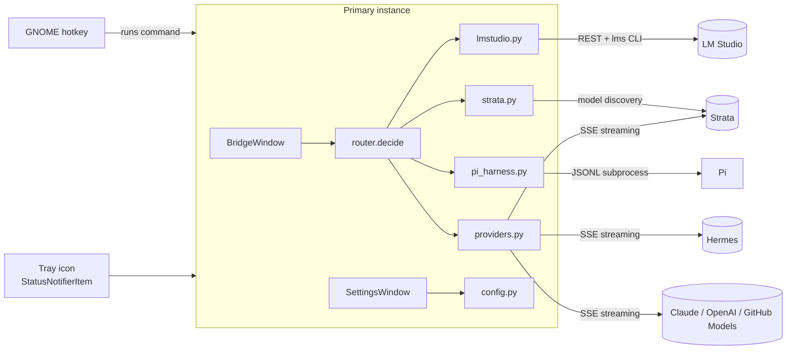

# Technical documentation

🇬🇧 English | 🇩🇪 [Deutsch](TECHNICAL.de.md)

## Overview

Python desktop application (GTK 4 via PyGObject and the standard library). A `Gtk.Application` with `HANDLES_COMMAND_LINE` keeps one primary instance alive (`hold()`); every further launch (the hotkey runs the same command) is forwarded to the primary instance, which toggles the overlay. Pi and other external tools run as separate processes.



## Modules (`src/lms_hermes_bridge/`)

| Module | Responsibility |
|--------|----------------|
| `app.py` | `BridgeApp` (single instance, actions, command line `--background`), `BridgeWindow` (overlay, right-click menu, worker thread), About and update dialogs |
| `router.py` | Pure decision logic: `classify`, `pick_model`, `decide`, `TIER_PARAMS`. No I/O |
| `lmstudio.py` | Model discovery (`GET /api/v0/models`, `lms ls --json` for sizes), `lms load/unload`, RAM detection |
| `strata.py` | Discovers models via Strata's OpenAI-compatible `GET /v1/models`; image support is configured explicitly |
| `pi_harness.py` | Runs Pi as a subprocess in JSON mode, streams text events, reports errors and terminates the process on cancellation |
| `desktop_context.py` | Clipboard/image payload validation and XDG Screenshot portal capture, with a 16 MB image limit |
| `updater.py` | Periodic fetch/count check; finds pipx's PEP 610 source checkout, verifies the expected GitHub remote, refuses dirty/non-main checkouts, fast-forward pulls and reinstalls with pipx |
| `update_window.py` | Confirmation-progress UI for updating; offers restart only after a successful reinstall |
| `providers.py` | Streaming clients: OpenAI-compatible (`/chat/completions`) and Anthropic (`/v1/messages`), SSE parsing, `ChatError` |
| `config.py` | JSON config in `~/.config/lms-hermes-bridge/config.json` (mode `0600`), defaults, deep merge, provider presets |
| `system_prompts.py` | German and English default system instructions; chooses the configured language prompt with default fallback |
| `settings_dialog.py` | Tabbed settings for language, backends, agents, routines, keywords and external providers |
| `tray.py` | StatusNotifierItem + `com.canonical.dbusmenu` over `Gio.DBusConnection`; `has_host()` checks for the `StatusNotifierWatcher` (without a host nothing ever draws an icon) and the symbolic icon carries the panel colour |
| `hotkey.py` | Registers a GNOME custom keybinding through `gsettings` (`Gio.Settings`) |
| `services.py` | Starts the local LM Studio server (`lms server start`, falling back to `lms daemon up`) and the Hermes gateway (`hermes gateway start`) when their health checks fail, then polls until they answer. Skips remote URLs, uninstalled tools and the disabled setting |
| `placement.py` | Brings the overlay to the top centre: layer-shell (`Gtk4LayerShell`) on compositors that grant it to ordinary clients, otherwise `XMoveWindow` with `_NET_WM_STATE_ABOVE`; `session.py` makes the choice and `__init__.py` forces XWayland only when layer-shell is not an option |
| `session.py` | pure, GTK-free decision which placement backend the session offers (`XDG_*`, `HYPRLAND_INSTANCE_SIGNATURE`, `SWAYSOCK`, typelib presence) |
| `keywords.py` | Compiles keyword lists (whole words, trailing `*` for word forms, filler articles) shared by agent routing and the routines table |
| `routines.py` | Built-in answers before any routing: weather (date phrase parser, location extraction, Open-Meteo geocoding + forecast, WMO code texts) and help (strong/weak triggers, topic matching, live status probe). `fetch`/`probe` are injectable for tests |
| `installer.py` | Detects a missing local LM Studio / Hermes (remote endpoints are ignored) and runs the official install script (`curl -fsSL <url> \| bash`) in a thread, streaming output; after LM Studio it runs `lms server start` |
| `install_window.py` | Modal progress window with live installer log |
| `uninstaller.py` | Confirmed GUI and terminal uninstall; optional cleanup of bridge configuration and individually selected component data |
| `i18n.py` | `STRINGS` dictionaries per language, `t(key)`, locale detection |

## Request flow

1. Context controls capture clipboard text, primary-selection text, image files, or a user-confirmed screenshot through the XDG Desktop Portal. Context is displayed beside the input and included with the prompt on submit.
2. `Enter` in the overlay starts a daemon thread (`_worker`); a `threading.Event` cancels the previous stream.
3. The selected backend discovers models through `lmstudio.list_models` or `strata.list_models`; `None` means discovery failed. Strata model image support is determined by the configured vision switch.
4. For image input, `router.decide(..., needs_image=True)` selects a local VLM. LM Studio can automatically load a preferred vision model; Strata manages model loading itself.
5. LM Studio can load an unloaded model via `lms load` (optionally after `lms unload --all`). Strata models returned by its API are treated as loaded.
6. OpenAI-compatible and Anthropic clients stream SSE; Pi runs in JSON mode with the prompt on stdin. Text is marshalled to the UI thread with `GLib.idle_add`.

All UI updates happen on the GTK main thread; worker code never touches widgets directly.

## Routines table

`config["routines"]` is a list of rows `{id, name, enabled, keywords, action, value}`. `routines.handle()` checks user rows first (top to bottom), then built-ins. Weather/help use their own detection plus optional extra keywords. The Google row opens an encoded query via `xdg-open`; fixed desktop rows open the browser, home/Downloads folders, terminal, calculator or GNOME system settings. These commands do not invoke a shell. Actions: `answer` (text), `command` (argv via `shlex`, placeholders substituted per argument, started detached without a shell), `url` (`xdg-open`, only http/https/mailto, `{input}` URL-encoded), `hermes`/`llm` (a `Redirect` that rewrites the prompt; the legacy `hermes` action forces the selected agent). `config.normalize_routines()` drops malformed rows and re-adds missing built-in rows.

## Routing

Classification (`router.classify`), first match wins:

| Tier | Trigger |
|------|---------|
| `agent` | action verbs (open, run, install, create file, schedule, ... and German equivalents) |
| `code` | programming keywords or a code fence |
| `deep` | analysis/plan/compare keywords or > 120 words |
| `fast` | ≤ 12 words |
| `balanced` | everything else |

Model choice (`router.pick_model`): embedding models are ignored; models larger than 75 % of total RAM are skipped (unless nothing else is left); a configured per-tier model key wins. Model size comes from the parameter count parsed from the key (`7b`, `8x7b`), else from `sizeBytes`. Already loaded models get a score bonus.

Backend (`router.decide`): forced route from settings, otherwise `agent` goes to the selected enabled agent (Hermes or Pi), and other requests go to the selected model backend (LM Studio or Strata). If the model backend is unavailable, the selected agent and then the first enabled external provider are fallbacks. Routing `local` never falls back. Image requests use a vision model from the selected model backend only.

`local_only` disables external providers and Pi, and rejects non-local configured model and Hermes endpoints. It is not a network sandbox for agent tools, user commands, backends or update checks.

## Tray and D-Bus

GTK 4 has no tray API, so `tray.py` exports two objects on the session bus:

- `/StatusNotifierItem` (`org.kde.StatusNotifierItem`): properties (`IconName`, `IconThemePath`, `Menu`, ...), `Activate` → show overlay.
- `/MenuBar` (`com.canonical.dbusmenu`): `GetLayout`, `GetGroupProperties`, `Event`, `EventGroup`, `AboutToShow(Group)`. The host (GNOME AppIndicator extension) shows this menu on right click.
- The host is the other side of the protocol: `has_host()` reads the names exported by the `StatusNotifierWatcher`. Without one — GNOME without the AppIndicator extension, wlroots without a bar applet — nothing draws an icon no matter how correct the rest is. The app says so instead of failing silently: a console warning, a hint line in the overlay and a menu button in the prompt window; the settings also open with `Ctrl+,`. The icon is named `*-symbolic` because hosts recolour symbolic icons to their own foreground, which keeps it visible on a light and a dark top bar.

The item registers with `org.kde.StatusNotifierWatcher` and re-registers whenever the watcher reappears. Menu labels are produced lazily, so they follow the current language.

## Hotkey

`hotkey.py` validates accelerators with `Gtk.accelerator_parse`, lists conflicts across the GNOME keybinding schemas, and writes the command as `env PYTHONPATH=<src> python3 -m lms_hermes_bridge` for source checkouts (the installed `lms-hermes-bridge` executable otherwise). `refresh_command()` repairs a stale command at startup.

Wayland forbids application-wide global shortcuts, so the app registers a GNOME custom keybinding (`org.gnome.settings-daemon.plugins.media-keys`) whose command launches the app. The primary instance receives the activation and toggles the window.

## Configuration schema

```json
{
  "language": "auto|en|de",
  "hotkey": "<Control><Alt>space",
  "start_on_login": true,
  "system_prompts": { "de": "...", "en": "..." },
  "check_updates": true,
  "update_check_interval_hours": 6,
  "local_only": false,
  "routing": "auto|local|hermes|provider:<id>",
  "local_backend": "lmstudio|strata",
  "agent_backend": "hermes|pi",
  "strata": { "url": "http://127.0.0.1:8080", "api_key": "", "vision": false },
  "pi": { "enabled": false, "executable": "pi", "model": "", "provider": "", "working_directory": "~" },
  "lmstudio": { "url": "...", "auto_load": true, "unload_others": true,
                "auto_load_vision_model": true,
                "preferred_fast": "", "preferred_balanced": "", "preferred_deep": "",
                "preferred_code": "", "preferred_vision": "" },
  "hermes": { "enabled": false, "endpoint": "...", "api_key": "", "model": "" },
  "providers": [ { "id": "", "name": "", "kind": "openai|anthropic",
                   "endpoint": "", "api_key": "", "model": "", "enabled": true } ],
  "check_components": true,
  "autostart_backends": true,
  "routines_enabled": true,
  "weather_location": "",
  "routines": [ { "id": "", "name": "", "enabled": true, "keywords": ["..."],
                  "action": "weather|help|answer|command|url|hermes|llm", "value": "" } ],
  "agent_keywords": { "en": ["..."], "de": ["..."] }
}
```

Writes are atomic (temp file + `os.replace`). API keys are stored in plain text; the file is only readable by the owner.

The legacy `routing: "hermes"` value selects the configured agent, preserving existing configuration files. Language `auto` follows the system locale and falls back to English.

The General settings switch creates or removes `~/.config/autostart/lms-hermes-bridge.desktop` immediately on save. The installer applies the persisted `start_on_login` value.

Automatic update checks use `updater.updates_available()` at startup and the configured interval. This only runs `git fetch` and `git rev-list`; when `origin/main` is ahead, app and tray menus refresh with an update label/icon. The destructive part (`git pull --ff-only` plus pipx reinstall) runs only after the user confirms.

## Uninstallation

The settings action and `lms-hermes-bridge-uninstall` remove the pipx package, autostart entry, desktop entry, icon and GNOME shortcut after confirmation. They preserve configuration and other components. The terminal entry point is installed with the bridge; see the [README](../README.md) for commands and prerequisites.

With `--delete-all`, the user must first close the bridge and components being removed. The command displays the bridge configuration directory (`$XDG_CONFIG_HOME/lms-hermes-bridge`, default `~/.config/lms-hermes-bridge`) and asks for confirmation. It then displays existing recognized paths and asks separately for each component:

| Component | Paths considered |
|-----------|------------------|
| LM Studio / llmster | `~/.lmstudio`, `~/.cache/lm-studio` |
| Pi | `~/.pi/agent` |
| Strata | `$STRATA_DATA_DIR`, or `$XDG_DATA_HOME/strata` (default `~/.local/share/strata`); `~/.strata`; and the Strata executable link if its target is inside the recognized installation |

Paths must pass the uninstaller's safety checks; unsafe paths and unrecognized installations require manual review. For a recognized Hermes wrapper and default home, the command runs `hermes uninstall --full --dry-run` and, after separate approval, launches the interactive Hermes uninstaller. Its own prompts determine whether full removal is actually performed; inspect its output and any remaining profiles or files.

After the choices, approved component paths and bridge configuration are removed before the bridge uninstalls itself. An interrupted confirmation stops the operation; later failures can leave partial changes and are reported. The command does not stop running processes, uninstall shared system packages, revoke provider credentials or securely erase files. Custom locations, symlinks, external models, backups, shell PATH entries, other package-managed installations and the Git checkout can remain. The LM Studio home pointer is retained for manual inspection.

## Adding things

- **Language:** add a dictionary to `STRINGS` in `i18n.py` (missing keys fall back to English); it appears in the settings automatically.
- **Provider type:** add a `stream_*` function in `providers.py`, register it in `stream()` and extend `KINDS` in `settings_dialog.py`.
- **Tier or heuristic:** edit the regexes and `TIER_PARAMS` in `router.py` and extend `tests/test_router.py`.

## Security notes

- Local-only mode restricts configured endpoints, but is not a system-wide network isolation mechanism; Pi is disabled in this mode.
- Pi can execute tools and modify files in its configured working directory; configure its model provider separately.
- Plain-text key storage is a known limitation (see roadmap: keyring).

## Tests

Run the suite with `PYTHONPATH=src python3 -m pytest`. Router, Strata and Pi adapter tests cover selection, API parsing, streaming and cancellation. Optional integration tests use `LMS_BRIDGE_TEST_PI=1` for an installed Pi with a local mock server and `LMS_BRIDGE_TEST_GUI=1` for GTK with a working display.
