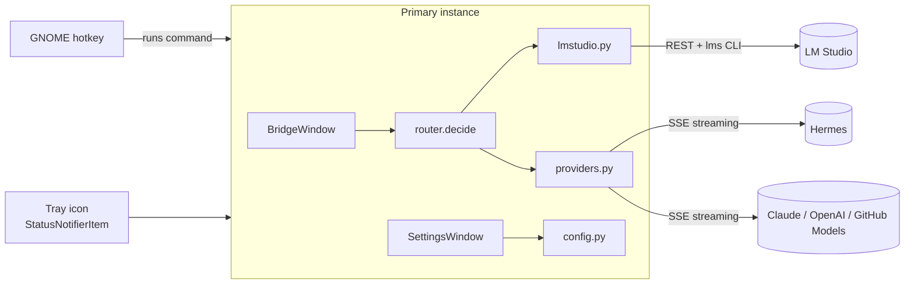

# Technical documentation

## Overview

Single-process Python application (GTK 4 via PyGObject, standard library only). A `Gtk.Application` with `HANDLES_COMMAND_LINE` keeps one primary instance alive (`hold()`); every further launch (the hotkey runs the same command) is forwarded to the primary instance, which toggles the overlay.



## Modules (`src/lms_hermes_bridge/`)

| Module | Responsibility |
|--------|----------------|
| `app.py` | `BridgeApp` (single instance, actions, command line `--background`), `BridgeWindow` (overlay, right-click menu, worker thread), About dialog |
| `router.py` | Pure decision logic: `classify`, `pick_model`, `decide`, `TIER_PARAMS`. No I/O |
| `lmstudio.py` | Model discovery (`GET /api/v0/models`, `lms ls --json` for sizes), `lms load/unload`, RAM detection |
| `providers.py` | Streaming clients: OpenAI-compatible (`/chat/completions`) and Anthropic (`/v1/messages`), SSE parsing, `ChatError` |
| `config.py` | JSON config in `~/.config/lms-hermes-bridge/config.json` (mode `0600`), defaults, deep merge, provider presets |
| `settings_dialog.py` | Tabbed settings window (General, LM Studio, Hermes, External models) |
| `tray.py` | StatusNotifierItem + `com.canonical.dbusmenu` over `Gio.DBusConnection` |
| `hotkey.py` | Registers a GNOME custom keybinding through `gsettings` (`Gio.Settings`) |
| `i18n.py` | `STRINGS` dictionaries per language, `t(key)`, locale detection |

## Request flow

1. `Enter` in the overlay starts a daemon thread (`_worker`); a `threading.Event` cancels the previous stream.
2. `lmstudio.list_models` fetches the model list. `None` means the server is unreachable.
3. `router.decide` returns a `Route` (backend, tier, model, params, `needs_load`) or `None`.
4. If the model is not loaded and auto-load is on, `lms load` runs (optionally after `lms unload --all`).
5. `providers.stream` yields text chunks; each is marshalled to the UI thread with `GLib.idle_add`.

All UI updates happen on the GTK main thread; worker code never touches widgets directly.

## Routing

Classification (`router.classify`), first match wins:

| Tier | Trigger |
|------|---------|
| `agent` | action verbs (open, run, install, create file, schedule, ... and German equivalents) |
| `code` | programming keywords or a code fence |
| `deep` | analysis/plan/compare keywords or > 120 words |
| `fast` | ≤ 12 words |
| `balanced` | everything else |

Model choice (`router.pick_model`): embedding models are ignored; models larger than 75 % of total RAM are skipped (unless nothing else is left); a configured per-tier model key wins. Model size comes from the parameter count parsed from the key (`7b`, `8x7b`), else from `sizeBytes`. Already loaded models get a score bonus.

Backend (`router.decide`): forced route from settings, else `agent` → Hermes (if enabled), else LM Studio. Fallbacks if LM Studio is unavailable: Hermes, then the first enabled external provider. `local_only` removes all external providers; routing `local` never falls back.

## Tray and D-Bus

GTK 4 has no tray API, so `tray.py` exports two objects on the session bus:

- `/StatusNotifierItem` (`org.kde.StatusNotifierItem`): properties (`IconName`, `IconThemePath`, `Menu`, ...), `Activate` → show overlay.
- `/MenuBar` (`com.canonical.dbusmenu`): `GetLayout`, `GetGroupProperties`, `Event`, `EventGroup`, `AboutToShow(Group)`. The host (GNOME AppIndicator extension) shows this menu on right click.

The item registers with `org.kde.StatusNotifierWatcher` and re-registers whenever the watcher reappears. Menu labels are produced lazily, so they follow the current language.

## Hotkey

Wayland forbids application-wide global shortcuts, so the app registers a GNOME custom keybinding (`org.gnome.settings-daemon.plugins.media-keys`) whose command launches the app. The primary instance receives the activation and toggles the window.

## Configuration schema

```json
{
  "language": "auto|en|de",
  "hotkey": "<Control><Alt>space",
  "local_only": false,
  "routing": "auto|local|hermes|provider:<id>",
  "lmstudio": { "url": "...", "auto_load": true, "unload_others": true,
                "preferred_fast|balanced|deep|code": "" },
  "hermes": { "enabled": false, "endpoint": "...", "api_key": "", "model": "" },
  "providers": [ { "id": "", "name": "", "kind": "openai|anthropic",
                   "endpoint": "", "api_key": "", "model": "", "enabled": true } ]
}
```

Writes are atomic (temp file + `os.replace`). API keys are stored in plain text; the file is only readable by the owner.

## Adding things

- **Language:** add a dictionary to `STRINGS` in `i18n.py` (missing keys fall back to English); it appears in the settings automatically.
- **Provider type:** add a `stream_*` function in `providers.py`, register it in `stream()` and extend `KINDS` in `settings_dialog.py`.
- **Tier or heuristic:** edit the regexes and `TIER_PARAMS` in `router.py` and extend `tests/test_router.py`.

## Security notes

- Local-only mode disables every external provider in the router.
- Endpoint URLs and keys are user-supplied; requests go only to configured endpoints.
- Plain-text key storage is a known limitation (see roadmap: keyring).

## Tests

`tests/test_router.py` covers parsing, classification, model choice, memory limits, fallbacks and Hermes routing. Run with `PYTHONPATH=src python3 -m pytest`.
